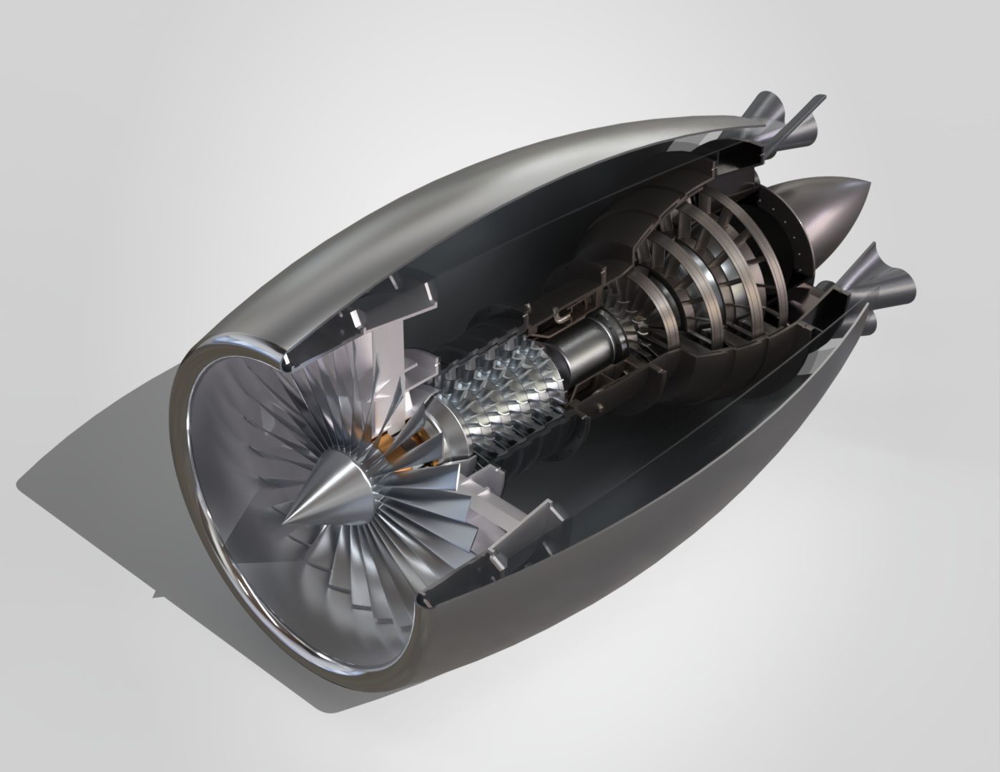
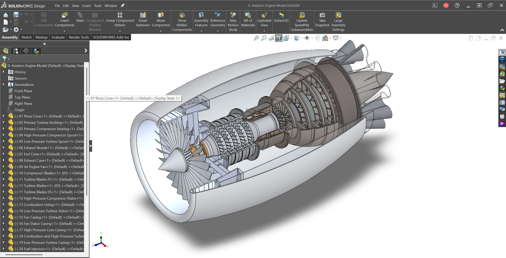
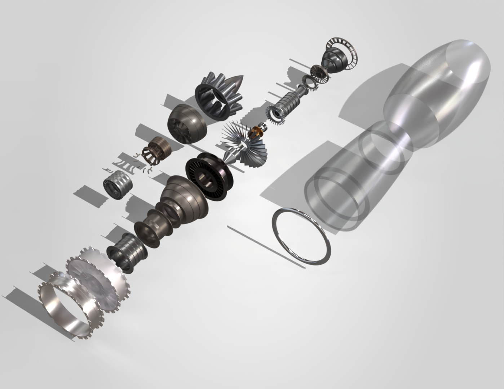
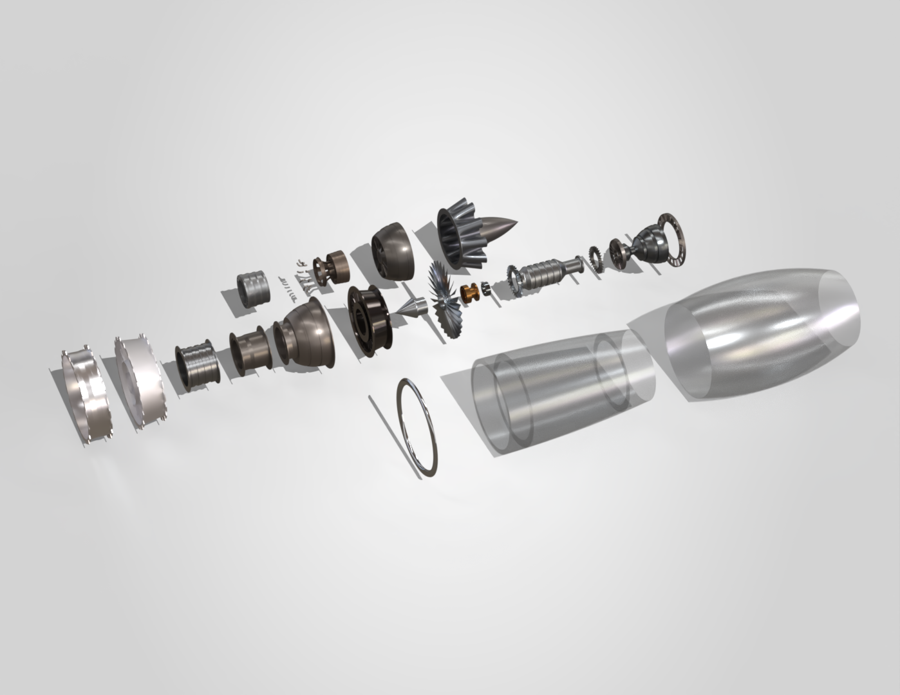

# Jet Engine Assembly | SolidWorks

**3D CAD Modeling · Motion Study · Rendering**

## Project Overview

This project explores the 3D modeling, assembly, motion visualization, and rendering of a jet engine using SolidWorks.

Using technical drawings and construction references as a foundation, I recreated the assembly while introducing dimensional adjustments and modifications to selected design features.

The objective was to practice SolidWorks tools and further develop my CAD modeling, assembly management, motion study, and rendering skills.

## CAD Modeling & Assembly

The project involved recreating individual components, defining assembly relationships, and organizing the complete jet engine model.

## Design Adjustments

Selected dimensions and modeling features were modified as part of my own CAD workflow. These adjustments were intended to explore alternative modeling approaches rather than establish validated improvements in engine performance.

## Exploded Views

Exploded views were created to illustrate component arrangement and assembly structure.

### Exploded View 01

### Exploded View 02

## Motion Study

A Motion Study was created in SolidWorks to visualize rotational movement and interactions between assembly components.

[View Motion Study Video](Jet-Engine-Motion-Study.mp4)

## Rendering & Visualization

The visualization process included working with materials, appearances, and lighting to present the assembly and its internal components.

## Software & Tools

- SolidWorks — 3D CAD Modeling & Assembly
- SolidWorks Motion Study — Motion Visualization
- Rendering tools — Materials, lighting, and visualization

## Credits & References

Special thanks to **ZD Mechanics** for providing the technical drawings and detailed construction references used as the foundation for this project.

The CAD reconstruction, selected dimensional and feature adjustments, motion study, and renderings presented here reflect my own implementation and workflow.

## Author

**Kevin Vargas García**  
Mechanical Engineer

[LinkedIn](https://www.linkedin.com/in/kevin-vargas-mechanicalengineer/)
